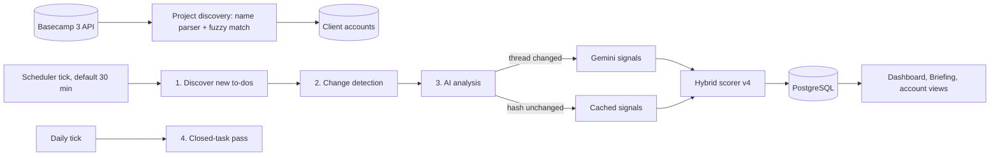

# Basecamp Radar

Know which Basecamp to-dos need you today, and why: an AI triage radar that reads every thread across your client accounts and puts the few that matter at the top.

> Built by **Satya Janghu**, a digital marketing expert specializing in SEO, AI search, and organic growth marketing. [getsatya.com](https://getsatya.com) · [satya@getsatya.com](mailto:satya@getsatya.com)


## Why it exists

An agency running SEO, PPC and content for dozens of clients ends up with hundreds of open Basecamp to-dos, and the urgent ones (a client waiting on an approval, a blocker buried in comment 14, a deadline two days out) look exactly like the routine ones in Basecamp's lists. Finding them means opening thread after thread every morning, and the ones that get missed are the ones clients notice. Basecamp Radar does that reading for you: it watches every open to-do, flags what is blocked, waiting on you or going stale, and gives each one a 0–100 priority score with the reasons spelled out.

## What it does

- **Ranks every open to-do across all client accounts** on one 0–100 scale, in five tiers from Critical to Minimal, so the morning starts with a short list instead of a full inbox.
- **Reads comment threads with Gemini** to spot blockers, direct mentions, approval requests and whose court the ball is in.
- **Explains every score** with a per-signal breakdown (staleness, deadline, activity, AI signals, multipliers), so the ranking can be trusted and checked.
- **Builds a Morning Briefing** of the top 50 Critical and High tasks across every account, with a split-panel detail view.
- **Onboards projects automatically** by parsing project names and fuzzy-matching them to client accounts; new to-dos are tracked without any setup.
- **Keeps triage keyboard-fast** with a command palette, vim-style shortcuts, nine stackable smart filters, and batch star, vote, dismiss and snooze actions.
- **Captures feedback for tuning** by storing a scoring snapshot with every upvote, downvote and dismissal.
- **Stays read-only against Basecamp**: it never posts, edits or reassigns anything.

## How it works



1. **Discovery.** The discovery page lists every Basecamp project, parses each name into client, project type (client-shared or internal) and service line, and fuzzy-matches the client name to an existing account. The user confirms, and from then on every open to-do in that project is tracked.
2. **Polling.** A background scheduler runs a four-pass cycle. It discovers new to-dos (including nested to-do list groups), detects changes by comparing Basecamp's `updated_at`, and re-analyzes only the tasks that actually changed. A daily pass catches reopened to-dos and archives tasks closed for more than three months.
3. **Analysis.** For changed tasks, Gemini reads the first comment plus the latest 15 and returns structured signals. A SHA-256 hash of the thread skips the call entirely when nothing new was said.
4. **Scoring.** Deterministic signals from task metadata are combined with the AI signals into a normalized score. Gemini detects; the code scores.
5. **Triage.** The dashboard, Morning Briefing and per-account views sort by score and show trend arrows against the previous score.

## Engineering highlights

- **Hybrid scoring model (v4).** Staleness follows a curve, `min(85, 25 + (days − 4) × 6)`, then decays to 0 at 45 days and becomes a −50 demerit at 60 days, so long-abandoned tasks stop crowding the top. Deadlines add up to +25, activity up to +15, blockers +50, direct mentions +45, approval requests +35. A recurring-task dampener (×0.7), a client-facing project multiplier (×1.4) and a producer staleness amplifier (×1.25) shape the result, which is normalized against a 300-point ceiling and capped at 100.
- **Tuned from real feedback.** v4's zero-engagement penalty, staleness decay, recurring dampener and producer amplifier were set from downvote and dismissal patterns, each captured with a full `vote_context` scoring snapshot.
- **Token-efficient AI.** Gemini is called only on real activity: change detection, a SHA-256 comment-thread hash, and a 7-day cache refresh. Unassigned tasks are skipped. With no API key the app falls back to deterministic-only scoring.
- **Structured, validated model output.** Gemini runs with a JSON `response_schema` at temperature 0.1, and every field is validated with safe defaults before it touches a score.
- **Rate-limit aware concurrency.** The async poller caps Basecamp concurrency at 10 requests with 200 ms minimum spacing (against Basecamp's 50 requests per 10 seconds), honors `Retry-After` on HTTP 429, and caps pagination at 100 pages. A thread-safe sliding-window limiter holds Gemini to 1,000 calls a minute and 10,000 a day.
- **Fault-isolated polling.** Each pass runs in isolation, so a problem in one never stops the cycle. Analysis never raises; tasks that can't be analyzed retry up to 3 times before pausing. Work commits in batches of 10 with explicit rollbacks, and every cycle is logged to `poll_runs` (last 50 kept).
- **Secure by default.** Constant-time password check, a signed `https_only` `SameSite=Lax` session cookie, an auth middleware on every route except `/login` and static files, and Basecamp OAuth 2.0 with a verified `state` parameter and automatic token refresh.
- **Test suite.** 86 pytest cases cover scoring tiers and curves, Gemini prompt and response handling, the rate limiter, project-name parsing and fuzzy matching, and the login and OAuth gate, with no database needed to run them.

At a glance: roughly 4,900 lines of Python, 40 HTTP routes, 22 Jinja templates and 10 Alembic migrations.

## Tech stack

| Layer | Technology |
|---|---|
| Runtime | Python 3.11 |
| Web | FastAPI, Uvicorn |
| UI | Jinja2, HTMX 2, Tailwind CSS, Lucide icons (no build step) |
| Data | PostgreSQL, SQLAlchemy 2.0, Alembic |
| AI | Google Gemini (`gemini-3-flash-preview`) via `google-genai` |
| Integrations | Basecamp 3 API with OAuth 2.0, httpx (sync and async) |
| Scheduling | APScheduler 4 |
| Matching | rapidfuzz |
| Hosting | Railway |
| Tests | pytest |

## Project evolution

**Started as** a design for a per-client "central brain": markdown context files for each client, fed into the AI prompt, with a planned browser-extension intake for capturing work.

**Became** a self-contained, read-only triage system over Basecamp. It discovers projects on its own, tracks every open to-do, uses Gemini only for what a model is good at (reading conversations), and keeps scoring deterministic and explainable. The scoring model is now a hybrid design (v4) tuned against how the ranked list is actually used.

## Roadmap

- Calibrate signal weights directly from the collected `vote_context` snapshots.
- Notifications or a daily digest when new Critical tasks appear.
- Per-account role settings beyond producer names.
- Multi-user accounts in place of the single shared password.

## Running it locally

**Prerequisites:** Python 3.11+, a PostgreSQL database, a Basecamp OAuth app with redirect URI `http://localhost:8000/auth/basecamp/callback`, and optionally a Gemini API key.

```bash
python -m venv .venv && source .venv/bin/activate
pip install -r requirements-dev.txt
cp .env.example .env   # set DATABASE_URL, PASSWORD, SECRET_KEY, BASECAMP_CLIENT_ID, BASECAMP_CLIENT_SECRET, optionally GEMINI_API_KEY
alembic upgrade head
uvicorn app.main:app --reload
```

Open `http://localhost:8000`, log in, connect Basecamp from Settings, then confirm projects on `/discover`. Optional overrides (`BASECAMP_USER_AGENT`, `RADAR_CORE_TEAM`, `RADAR_TIMEZONE`) are listed in `.env.example`. Run the tests with `pytest`.

## Documentation

- [Architecture](docs/ARCHITECTURE.md): polling passes, the scoring model, triage features, endpoints, configuration and deployment.
- [Schema reference](docs/schema-reference.md): tables, JSONB shapes and the Gemini prompt.

## About the author

> Built by **Satya Janghu**, a digital marketing expert specializing in SEO, AI search, and organic growth marketing. [getsatya.com](https://getsatya.com) · [satya@getsatya.com](mailto:satya@getsatya.com)

Satya builds agency-operations tooling so project managers start each day acting on priorities instead of searching for them.

## License

All rights reserved. See [LICENSE](LICENSE).
