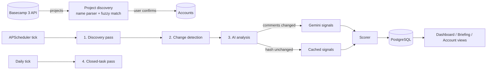

# Architecture

Basecamp Radar is a single-user web application that watches every open to-do across an agency's Basecamp 3 projects, reads the comment threads with Gemini, and ranks the work on a 0-100 priority score. It is **read-only** against Basecamp: it never posts, edits, or reassigns anything.

## Design principles

- **Read-only integration.** Basecamp is the system of record; the radar only observes it.
- **Spend AI tokens only on real activity.** Change detection plus a SHA-256 hash of the formatted comment thread decide whether Gemini is called at all.
- **The model detects, the code scores.** Gemini returns boolean and categorical signals; the point values, multipliers and tiers live in `app/services/scorer.py`, so every score is explainable and reproducible.
- **Explicit tuning, no silent learning.** Upvotes, downvotes and dismissals are stored with a scoring snapshot, and the scoring model is adjusted deliberately from that data.
- **Single user, simple auth.** One password, a signed session cookie (180 days, `https_only`, `SameSite=Lax`), and an auth middleware that protects every route except `/login` and `/static/`.

## Tech stack

| Layer | Choice |
|-------|--------|
| Runtime | Python 3.11 (`runtime.txt`) |
| Web | FastAPI with sync route handlers (run in FastAPI's threadpool) |
| UI | Jinja2 templates, HTMX 2, Tailwind CSS (CDN), Lucide icons; no build step |
| Database | PostgreSQL, SQLAlchemy 2.0 (sync) + psycopg2, Alembic migrations |
| HTTP | httpx: sync `Client` in routes, `AsyncClient` in the background poller |
| AI | Gemini (`gemini-3-flash-preview`) via the `google-genai` SDK, JSON-schema structured output, temperature 0.1 |
| Scheduling | APScheduler 4 `AsyncScheduler`, started from the FastAPI lifespan |
| Matching | rapidfuzz `token_sort_ratio` for client-name matching |
| Hosting | Railway (Railpack builder), config in `railway.json` |

### Sync/async strategy

Database access is synchronous SQLAlchemy everywhere (simple, Alembic-friendly). Route handlers use a sync `BasecampClient`. The background poller runs inside APScheduler's async scheduler and uses `AsyncBasecampClient` for concurrent fetches, while still writing through sync SQLAlchemy sessions. Gemini calls from the poller run in a worker thread (`asyncio.to_thread`) so the event loop is never blocked.

## Core flow



1. **Onboarding.** The discovery page lists every Basecamp project, parses the project name, fuzzy-matches the client name to existing accounts, and lets the user accept, reassign, create or skip each one.
2. **Tracking.** Once a project belongs to an account, every open to-do in it is tracked automatically.
3. **Polling.** A scheduled poll cycle discovers new to-dos, detects changes, and re-analyzes only tasks with new activity.
4. **Scoring.** Deterministic signals from task metadata are combined with Gemini's content signals into a normalized 0-100 score and one of five tiers.
5. **Triage.** The dashboard, Morning Briefing and per-account views present tasks sorted by priority, with keyboard-driven actions.

## Project discovery

Projects are expected to follow the naming convention `| {Client Name} | // {Joint|Internal} // {Service Type}`, for example `| Acme Roofing Co. | // Joint // SEO & PPC`. The parser (`PROJECT_NAME_PATTERN` in `app/services/discovery.py`) extracts the client name, project type and service type. Client names are matched to existing accounts with rapidfuzz; matches below a confidence of **70** are discarded. Projects created in the same confirmation batch for the same new client name are grouped under one account.

- **Joint** projects are shared with the client (client-facing, higher urgency).
- **Internal** projects are agency-only coordination.

## Polling architecture

```
Poll cycle (global interval, default 30 min; floor 5 min):
  0. Compute due projects   per-project poll_interval_minutes overrides the global interval
  1. Discovery              auto-track new open to-dos in due projects, including nested
                            to-do list groups (recursive, MAX_GROUP_DEPTH = 5)
  2. Change detection       fetch to-do metadata, compare updated_at, close completed to-dos
  3. AI analysis            only tasks flagged has_new_activity, tasks whose AI cache is older
                            than 7 days, and "partial" tasks below the retry limit
Daily:
  4. Closed-task pass       re-open to-dos reopened in Basecamp; archive tasks closed > 3 months
```

- The scheduler tick is `max(5, min(global interval, all per-project overrides))`; each project records `last_polled_at` so it is only polled when due.
- Each pass is isolated: a failure in one pass is logged and counted, and the cycle continues.
- Every cycle is recorded in `poll_runs` (duration, discovered, changed, analyzed, skipped, errors); the last 50 runs are kept.
- A `poll_running` config flag drives the live progress bar on the dashboard and is always cleared in a `finally` block.

### Token efficiency

- Comment threads are formatted (first comment + last 15) and hashed with SHA-256. If the hash matches the last analysis and the cache is fresher than **7 days**, Gemini is skipped and the task is re-scored from cached signals, so staleness and deadlines stay current at zero AI cost.
- Unassigned tasks are skipped entirely (and hidden from all views until someone is assigned).
- Without a `GEMINI_API_KEY`, the system degrades to deterministic-only scoring.

### Resilience

- Gemini failures never raise: `analyze_task()` returns `(signals, success)`, so callers can tell "nothing found" from "AI failed". Failed tasks are marked `partial`, retried automatically, and paused as `error` after **3** consecutive failures.
- Analysis commits in batches of **10** tasks, with explicit rollback on errors.
- Stored comments are capped at the latest **20** per task to bound JSONB growth.
- Pagination follows `Link: rel="next"` headers with a 100-page safety limit.

### Rate limiting

- **Basecamp** allows 50 requests per 10 seconds. Both clients enforce 200 ms minimum spacing (guarded by an `asyncio.Lock` in the async client), back off on HTTP 429 using `Retry-After` (default 3 s), and the poller caps concurrency at **10** requests with a semaphore.
- **Gemini** calls pass through a thread-safe sliding-window limiter (1,000 requests/minute, 10,000/day). Its live usage is exposed at `GET /api/radar/status`.

## Hybrid scoring model (v4)

### Deterministic signals (`scorer.py`)

| Signal | Points | Logic |
|--------|--------|-------|
| Staleness (continuous) | -50 to 85 | 4-44 days: `min(85, 25 + (days - 4) * 6)`; 45-59 days: 0 (decay); 60+ days: -50 (demerit); x1.25 when a producer is an assignee or completion subscriber |
| Deadline: overdue | +25 | `due_date` in the past |
| Deadline: 0-1 days | +20 | |
| Deadline: 2-3 days | +15 | |
| Deadline: 4-5 days | +10 | |
| Deadline: 6-7 days | +5 | |
| Activity: 3-4 comments | +5 | |
| Activity: 5-9 comments | +10 | |
| Activity: 10+ comments | +15 | |
| Zero engagement | -10 | 0 comments and more than 30 days stale |
| Recurring dampener | x0.7 | Title contains `[Recurring]` or `(Recurring)`; applied before the joint multiplier |
| Joint project | x1.4 | Applied after the sum, before normalization |

Staleness is measured in days since the latest comment (`last_known_activity_at`, falling back to `added_at`). Due dates are evaluated in the configured `RADAR_TIMEZONE`.

### AI-detected signals (`gemini.py`)

| Signal | Points |
|--------|--------|
| Blocker detected | +50 |
| Direct mention of a producer | +45 |
| Approval / review request | +35 |
| Ambiguous ownership | +10 |
| Ball with a producer | +20 |
| Ball not with a producer | -15 |
| Stage: pending_review | +15 |
| Stage: pending_client | -10 |
| Stage: blocked | +5 |
| Stage: completed | -20 |

### Star boost

Starring a task adds **+60 raw points**, but only when a qualifying condition exists: blocker, mention, approval request, ambiguous ownership, `pending_review`, or staleness between 8 and 44 days. Starring a quiet task does not inflate it.

### Formula and tiers

```
score = min(100, round(max(0, raw_sum) x recurring_dampener x joint_multiplier / 300 x 100))
```

The denominator of **300** is the non-joint ceiling of the base signals (85 + 25 + 15 + 50 + 45 + 35 + 10 + 20 + 15). Joint tasks and starred tasks can exceed it and are capped at 100.

| Tier | Score | Grouped tab |
|------|-------|-------------|
| Critical | >= 80 | Urgent |
| High | 60-79 | Urgent |
| Medium | 35-59 | Monitor |
| Low | 15-34 | Background |
| Minimal | 0-14 | Background |

Every task stores a full `score_breakdown` JSONB (per-signal points, multipliers, raw and normalized totals) that drives the stacked score bar in the task detail panel. `previous_score` and `previous_tier` are kept so cards show trend arrows.

### Producer names

`RADAR_CORE_TEAM` lists the names that are always monitored. Each account can add further producers (for example account leads) in its settings; `get_relevant_names()` merges and de-duplicates them per task. Names are matched by case-insensitive substring because Basecamp stores full names while Gemini is asked for first names.

## Gemini integration

Gemini receives the task metadata (title, project and type, client account, all assignees, completion subscribers, which of the team appear in each, due date, days since last comment, comment count) plus the formatted comment thread (first comment + last 15, HTML stripped) and the list of producer names. The prompt is self-contained. The response is constrained by a JSON schema and validated field by field (`_validate_response`), falling back to safe defaults for anything missing or malformed:

`is_blocked`, `blocked_reason`, `has_direct_mention`, `needs_approval`, `ownership_ambiguous`, `ball_with`, `current_stage` (one of `new`, `in_progress`, `pending_review`, `pending_client`, `blocked`, `completed`), `recommendation`, `urgency_factors`.

The app maps these signals to points; Gemini never computes the score. `GeminiClient` is a module-level singleton for connection reuse.

## Triage features

- **Morning Briefing** (`/briefing`): the top 50 Critical and High tasks across all accounts, sorted by score, with a split-panel detail view and a mobile drawer.
- **Smart filters** (account view and briefing; AND logic; URL-shareable via `?filters=`): `ball_with_me`, `blocker`, `approval`, `stale7`, `starred`, `upvoted`, `downvoted`, `dismissed`, `snoozed`.
- **AI reasoning panel**: blocked reason, urgency factors, negative stage deductions, and analysis metadata (last analyzed, status, error count).
- **Staleness badges** at 4+ days: 4-5d, 6-7d, 8-14d, 15d+.
- **Batch actions**: `x` enters selection mode, Shift+x / Shift+click selects ranges; open in Basecamp, star/unstar, upvote/downvote, dismiss, snooze. Batch endpoints are capped at 50 tasks.
- **Command palette** (`/`): jump to any account or page, or trigger a poll.
- **Keyboard navigation**: `j`/`k` move, `Enter` opens, `Esc` closes, `o` opens in Basecamp, `r` refreshes, `s` stars, `d` dismisses, `?` shows help, `1`-`4` switch tier tabs, `g` then `b`/`d`/`s`/`h` navigates, `p` triggers a poll.
- **Dismiss / snooze / vote**: dismissing hides a task until restored and records an implicit downvote; snoozing hides it until a chosen time (presets: tomorrow 9am, next Monday 9am, one week); the two are mutually exclusive. Votes (+1 / -1) do not change scores; each stores a `vote_context` snapshot (score, tier, staleness, signals, stage, breakdown, source) for later analysis.

## Data model

- **accounts**: client accounts with a JSONB `projects` array `[{id, type, service_type, basecamp_name, producers, poll_interval_minutes, last_polled_at}]`.
- **tasks**: tracked to-dos with lifecycle status (`active` -> `closed` -> `archived`), scores and trends, the AI analysis cache, comment hash, star/dismiss/snooze/vote state, `analysis_status` (`pending`, `partial`, `complete`, `error`) and `analysis_error_count`. Unique on `(basecamp_bucket_id, basecamp_todo_id)`; indexed on `status`, `priority_tier`, and `(account_id, status, priority_tier)`.
- **config**: key-value settings and OAuth tokens (poll interval, closed-check interval, archive threshold, last poll time).
- **poll_runs**: poll-cycle history (last 50).

Column-level detail, JSONB examples and the full prompt are in [schema-reference.md](schema-reference.md).

## Code map

| Path | Responsibility |
|------|----------------|
| `app/main.py` | App factory, middleware, config seeding, scheduler lifespan |
| `app/auth.py` | Password check and auth middleware |
| `app/config.py` | Environment settings (pydantic-settings) |
| `app/constants.py` | `CORE_TEAM`, `USER_TIMEZONE`, producer-name and project lookup helpers |
| `app/services/basecamp.py` | Sync and async Basecamp 3 clients with rate limiting and pagination |
| `app/services/discovery.py` | Project-name parser, fuzzy matching, discovery confirmation |
| `app/services/poller.py` | The four poll passes |
| `app/services/scheduler.py` | APScheduler lifecycle and poll-cycle orchestration |
| `app/services/gemini.py` | Prompt, structured output, validation, rate limiter |
| `app/services/scorer.py` | Signal configuration, scoring pipeline, display segments |
| `app/routes/` | Pages, auth/OAuth, accounts, discovery, task actions, settings |
| `app/templates/` | Jinja2 pages, HTMX partials, tier and icon macros |
| `app/static/batch.js` | Shared batch-selection logic |
| `migrations/` | Alembic migrations |
| `tests/` | pytest suite for scoring, parsing, prompt building and auth |

## HTTP endpoints

| Method and path | Purpose |
|-----------------|---------|
| `GET /`, `GET /partials/dashboard-stats` | Dashboard and its auto-refresh partial |
| `GET /briefing`, `GET /briefing/tasks` | Morning Briefing page and filtered list partial |
| `GET /accounts/{id}`, `GET /accounts/{id}/tasks` | Account view and filtered task-list partial |
| `GET /accounts/{id}/tasks/{task}/detail` / `/comments` | Task detail panel and full comment list |
| `POST /accounts/{id}/tasks/{task}/refresh` | Re-fetch and re-analyze one task |
| `POST /accounts/{id}/tasks/{task}/star` / `/vote` | Toggle star (re-scores) / set or clear a vote |
| `POST /accounts/{id}/tasks/{task}/dismiss` / `/snooze` / `/restore` | Visibility controls |
| `POST /accounts/{id}/refresh` | Mark all of an account's tasks for re-analysis |
| `POST /api/tasks/batch-star` / `batch-dismiss` / `batch-snooze` / `batch-vote` | Batch actions (max 50 tasks) |
| `POST /api/radar/refresh` | Trigger an immediate poll cycle |
| `POST /api/radar/reanalyze` | Mark all active tasks for re-analysis and poll |
| `GET /api/radar/status` | Last poll, running state, task counts, Gemini rate-limit usage |
| `GET /discover`, `POST /discover/confirm` | Project discovery |
| `GET/POST /settings` | Global poll settings and poll history |
| `GET /auth/basecamp`, `GET /auth/basecamp/callback`, `POST /auth/basecamp/disconnect` | Basecamp OAuth 2.0 (with `state` verification) |

## Basecamp API usage

- Base URL `https://3.basecampapi.com/{account_id}/`; the account ID is discovered from `launchpad.37signals.com/authorization.json` after OAuth.
- OAuth 2.0 tokens are stored in the `config` table and refreshed automatically on expiry.
- Endpoints used: `projects.json`, `projects/{id}.json`, `buckets/{project}/todosets/{todoset}/todolists.json`, `buckets/{project}/todolists/{list}/todos.json`, `buckets/{project}/todolists/{list}/groups.json`, `buckets/{bucket}/todos/{todo}.json`, `buckets/{bucket}/recordings/{todo}/comments.json`.
- Requests identify the app through `BASECAMP_USER_AGENT`, as Basecamp's API terms require.

## Configuration

| Variable | Required | Description |
|----------|----------|-------------|
| `DATABASE_URL` | yes | PostgreSQL connection string |
| `PASSWORD` | yes | Login password |
| `SECRET_KEY` | yes | Session-cookie signing key |
| `BASECAMP_CLIENT_ID` / `BASECAMP_CLIENT_SECRET` | yes | Basecamp OAuth app credentials |
| `GEMINI_API_KEY` | no | Enables AI analysis |
| `BASECAMP_USER_AGENT` | no | App name and contact sent to Basecamp |
| `RADAR_CORE_TEAM` | no | Comma-separated always-monitored producer names |
| `RADAR_TIMEZONE` | no | IANA timezone for due dates and timestamps (default `America/Los_Angeles`) |

Poll interval (30 min), closed-task check interval (24 h) and archive threshold (3 months) are seeded into the `config` table at startup and editable on the Settings page.

## Deployment

- Railway with the Railpack builder; Python 3.11 pinned in `runtime.txt`.
- Start command (`railway.json`): `alembic upgrade head && uvicorn app.main:app --host 0.0.0.0 --port $PORT --proxy-headers --forwarded-allow-ips='*'`, so migrations run on every deploy.
- HTMX and Tailwind are CDN-served; there is no front-end build step.

## Tuning the scoring model

1. Query tasks with their `score_breakdown`, `vote` and `vote_context` (read-only) to find patterns, such as downvoted tasks that scored High.
2. Adjust `SIGNAL_CONFIG` and the constants in `app/services/scorer.py`, or the prompt in `app/services/gemini.py`.
3. Update the expectations in `tests/test_scorer.py` and run `pytest`.
4. Deploy, then use **Settings -> Force Re-Analysis** (`POST /api/radar/reanalyze`) to re-score every active task.
